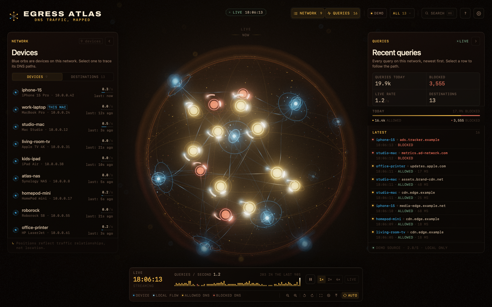

<p align="center">
  



Egress Atlas is a macOS app that turns your Pi-hole's DNS traffic into a map. Devices on your network sit on the surface of a globe, the domains they look up sit inside it, and every query travels along a wire between them. Allowed lookups glow gold, blocked lookups coral, and new or disappearing destinations play short animations instead of filling another log table. It opens on an offline demo network, so you can try it before connecting anything.

When you connect a Pi-hole v6 server, Egress Atlas reads recent DNS queries and keeps polling for new ones. The connection is direct and read-only: the app never changes your Pi-hole configuration, keeps the API password in the macOS Keychain, and sends no data anywhere else. Set a local alias for any device or DNS destination and its cards will use that name; a device alias replaces the name while its IP stays visible, and Display → Show domain with alias adds the original domain beside a destination alias. Drag to orbit the globe, right-drag to move it around the window, and leave auto-orbit on to keep it spinning while you do; the surrounding starfield and space dust stay anchored while the globe moves.

## Requirements

- macOS 15 or later
- Xcode 16 or later (Swift 6 toolchain)
- A Pi-hole v6 server on your local network, if you want live data

## Build and run

Egress Atlas is not distributed through the App Store and is not notarized. Build it from source and sign it locally:

```sh
git clone https://github.com/awychoi/egress-atlas.git
cd egress-atlas/macos
./scripts/build-app.sh
open "dist/Egress Atlas.app"
```

The script builds with SwiftPM, assembles the app bundle, renders its icon and signs the result. It ad-hoc signs by default, which is enough to run the app on the machine that built it.

For a stable local signing identity, create a self-signed code-signing certificate named `Egress Atlas Local` in Keychain Access (Certificate Assistant → Create a Certificate…, choose Code Signing), then build with it:

```sh
SIGN_IDENTITY="Egress Atlas Local" ./scripts/build-app.sh
```

The stable identity keeps macOS from treating each rebuild as a different app, so local-network permissions persist. Launch the built `.app` rather than the bare SwiftPM executable; the bundle is what gives macOS the app identity. `./scripts/build-app.sh --debug` produces `dist/Egress Atlas Debug.app`.

If macOS blocks the app after it has been moved or downloaded, allow it in **System Settings → Privacy & Security**, or remove the quarantine flag:

```sh
xattr -dr com.apple.quarantine "dist/Egress Atlas.app"
```

## Connect a Pi-hole

Open **Settings → Source** (or the source chip in the top bar), enter your Pi-hole's URL — for example `http://pi.hole` — and its API password, then connect. Egress Atlas imports a six-hour snapshot and polls the last three minutes. The app reads only; it never writes configuration back to Pi-hole.

## About Pi-hole

Egress Atlas works with [Pi-hole](https://github.com/pi-hole/pi-hole), the open-source network-wide ad blocker. Egress Atlas is an independent project and is **not affiliated with, endorsed by, or supported by the Pi-hole project**.

## Technical write-up

The scene model, layout, Metal rendering pipeline, Pi-hole client, packaging and self-signing are documented in [TECHNICAL.md](TECHNICAL.md).

## License

Egress Atlas. Copyright © 2026 wychoi.

Egress Atlas is free software under the [GNU General Public License v3.0](LICENSE) (GPLv3): you can redistribute it and/or modify it under the terms of the GPLv3. It is distributed **without any warranty**, to the extent permitted by law.
