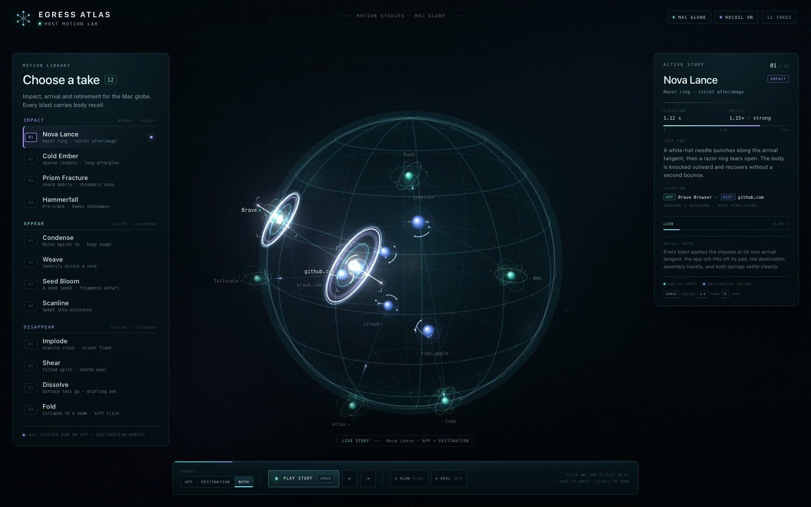
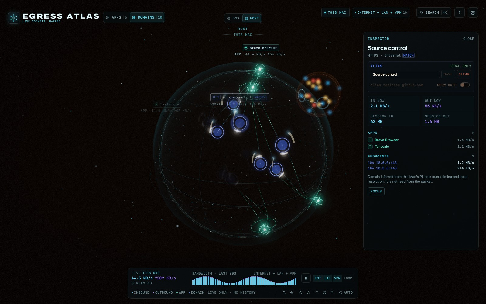

# Host Motion Lab

A standalone browser lab for auditioning motion studies on the HOST (Mac) globe. It draws a cool, projected globe with **app bodies on the shell** and **destination bodies inside**, and every study can run on either body type — or on both at once.

Open `index.html` directly in a browser. There is no build step, package install, network request, or dependency.

## The 12 takes

| Impact · blast + recoil | Appear · birth | Disappear · retire |
| --- | --- | --- |
| **Nova Lance** — razor ring, violet afterimage | **Condense** — motes spiral in, body snaps | **Implode** — gravity crush, silent flash |
| **Cold Ember** — cyan cinders, long afterglow | **Weave** — tendrils stitch a core | **Shear** — tilted split, shards peel |
| **Prism Fracture** — shard debris, chromatic echo | **Seed Bloom** — seed lands, filaments unfurl | **Dissolve** — surface lets go, drifting ash |
| **Hammerfall** — pre-crack, heavy shockwave | **Scanline** — swept into existence | **Fold** — collapse to a seam, soft click |

Every impact applies a real spring recoil to the struck body: the ring stays anchored at the arrival point while the app orb or destination assembly travels and settles. App bodies lift off their shell pad; destination bodies move as a whole. The other two families drive presence from `0 → 1` / `1 → 0`.

## Controls

- **Click a take** in the left library to play it on the current target.
- **Click any orb** (app or destination) to run the selected take on that body only.
- **Target** buttons: `APP`, `DESTINATION`, `BOTH` (the default).
- **PLAY STUDY** / `Space` replays; `1–4` selects a take in the current family.
- **SLOW** slows the simulation to `0.35×`; **REEL** auto-plays all 12.
- `←` / `→` steps takes; `T` cycles the target; `R` toggles the reel; `S` toggles slow motion.
- Drag the globe to orbit; scroll to zoom. Orb clicks and drags are distinguished by movement.

## Still / screenshot flags

`index.html?freeze=1&study=impact&variant=0&target=both&t=0.38&ui=0` freezes a deterministic frame. `study` is `impact | appear | disappear`, `variant` is `0–3`, `target` is `app | domain | both`, and `ui=0` hides the chrome for a clean capture. `auto=0` prevents the launch auto-play.

## Files

- `index.html` · shell, controls and notes markup
- `style.css` · instrument-style layout, responsive rules
- `app.js` · canvas renderer, globe field, 12 motion studies, UI logic
- `assets/brand-mark-host.png` · host mark
- `preview.jpg` · still from the impact pairing

The native integration now lives in `Scene/HostMotionEffects.swift`: apps reserve Nova/Hammer, Weave/Scanline and Fold/Dissolve; destinations reserve Cold Ember/Prism Fracture, Condense/Seed Bloom and Implode/Shear. This folder remains the reference lab behind that implementation.

